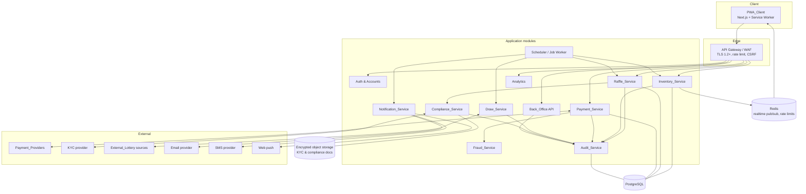
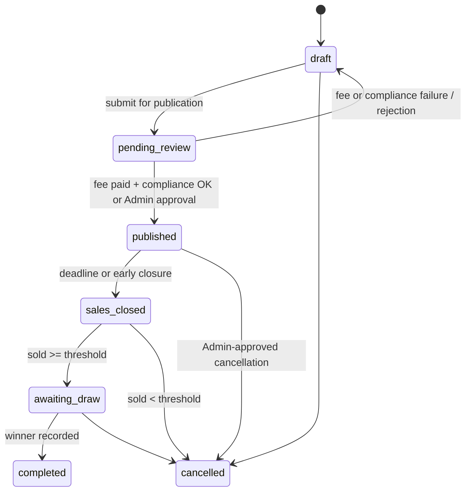
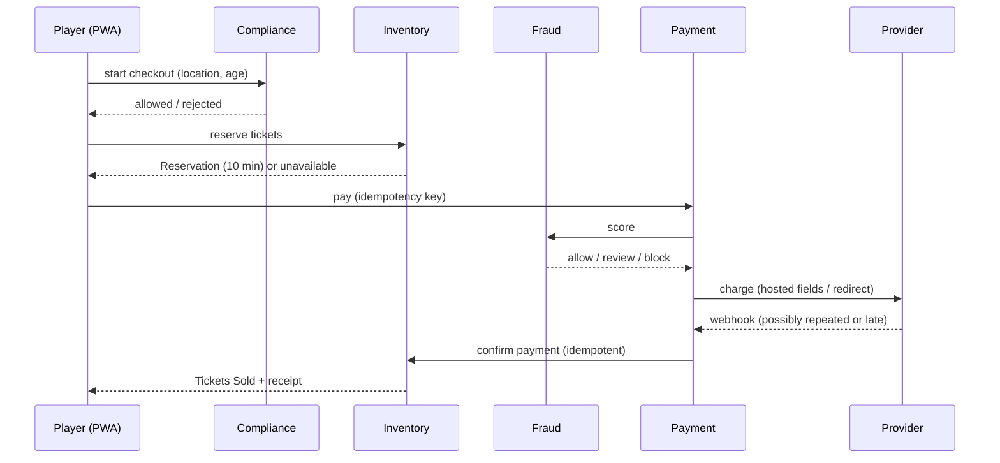
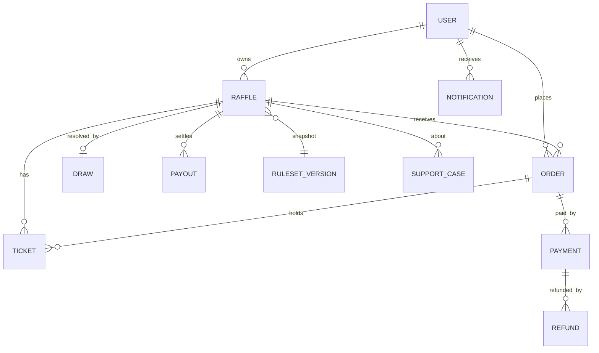

# Design Document

## Overview

The Raffle Platform is a bilingual (en/es) PWA where Owners create raffles tied to an External_Lottery draw, Players buy tickets with local payment methods (Colombia: PSE, Nequi, cards, Efecty; US: cards, Apple Pay, Google Pay, ACH), and the Platform derives the winner from the official lottery result and notifies everyone by email and SMS. The design also covers KYC, compliance, fraud scoring, refunds, payouts, an append-only audit trail, and an admin back office.

### Key Design Decisions

| Decision | Rationale |
|---|---|
| Modular monolith in TypeScript (Node.js), split into the services named in the requirements as internal modules with clear interfaces | Keeps transactional consistency for inventory, payments and audit (Req 18.9, 25.3) while allowing later extraction. |
| PostgreSQL as system of record, with row-level locking and unique constraints for ticket reservation | Guarantees one winner of a concurrent reservation (Req 4.4, 25.3). |
| Money stored as integer minor units plus ISO currency (COP has 0 decimals in practice, USD 2) using a decimal library for math | Avoids floating-point error; supports the ledger invariant (Req 14.9). |
| Durable job queue and scheduler backed by PostgreSQL (for example pg-boss or Graphile Worker) with unique job keys | Exactly-once scheduled occurrences across restarts (Req 25.6) and retry with backoff (Req 25.5). |
| Pure "domain core" functions (validation, state machines, winner derivation, refund planning, ledger) separated from I/O adapters | Makes the logic property-testable (see Testing Strategy). |
| Payment, KYC, SMS, email and lottery sources behind adapter interfaces | Providers vary by country and can be unavailable (Req 25.5). Providers to be selected, for example Wompi/PayU/Mercado Pago for Colombia and Stripe for the US, Twilio for SMS, and an email API. |
| Hash-chained audit table written in the same DB transaction as the audited operation | Satisfies tamper evidence and fail-closed behavior (Req 18.8, 18.9). |
| Next.js (React) PWA with a service worker (Workbox), i18n via resource files (for example i18next) | Meets PWA, localization and SSR for Open Graph metadata (Req 16.6, 20, 21). |

Research notes: card data stays with provider hosted fields or redirects, which keeps the Platform out of PCI SAQ-D scope (Req 6.3). Colombian raffles and US state raffles are legally regulated, so the compliance engine is data-driven (rule sets as versioned configuration) and needs legal validation before launch, as noted in the requirements.

## Architecture



### Raffle Lifecycle



### Reservation and Payment Flow



### Concurrency Strategy

- Reservation uses a single SQL transaction: `UPDATE ticket SET status='reserved', reservation_id=$1 WHERE raffle_id=$2 AND number = ANY($3) AND status='available'`; if affected rows differ from requested count the transaction rolls back (all-or-nothing, Req 5.3, 5.4).
- Tickets have a unique `(raffle_id, number)` key and a check constraint on status values. Counters are derived by `COUNT(*) GROUP BY status` or maintained in the same transaction.
- Payment webhooks are deduplicated by `(provider, provider_reference)` and processed with `SELECT ... FOR UPDATE` on the payment row, making confirmation idempotent (Req 5.9).
- Scheduled jobs use unique keys `(job_type, entity_id, occurrence)` so restarts neither skip nor duplicate them (Req 25.6).

## Components and Interfaces

Interfaces are shown in TypeScript. `Result<T,E>` is a discriminated union of success or typed error.

### Auth & Accounts

```ts
interface AuthService {
  register(input: RegistrationInput): Promise<Result<AccountId, FieldErrors>>;
  signIn(email: string, password: string): Promise<Result<SignInOutcome, AuthError>>;
  verifyMfa(challengeId: string, code: string): Promise<Result<Session, AuthError>>;
  requestPasswordReset(email: string): Promise<void>; // always generic response
  resetPassword(token: string, newPassword: string): Promise<Result<void, ResetError>>;
}
// Pure core
function validateRegistration(i: RegistrationInput, now: Date, emailTaken: boolean): FieldErrors | null;
function nextLockState(s: LockState, attempt: {at: Date; ok: boolean}): LockState;
```

Passwords use Argon2id. Sessions use httpOnly, secure, SameSite cookies plus a CSRF token on state-changing requests. Owners and Admins are always routed through MFA.

### Raffle_Service

```ts
interface RaffleService {
  saveDraft(ownerId: string, input: RaffleInput): Promise<Result<Raffle, FieldError[]>>;
  submitForPublication(raffleId: string): Promise<Result<Raffle, PublishError>>;
  cancel(raffleId: string, actor: Actor, reason: string): Promise<Result<void, CancelError>>;
}
// Pure core
function validateRaffle(input: RaffleInput, now: Date): FieldError[];
function validateEdit(existing: Raffle, patch: Partial<RaffleInput>, soldCount: number): FieldError[];
function transition(status: RaffleStatus, event: RaffleEvent): RaffleStatus | IllegalTransition;
function closureDecision(s: ClosureInput): "none" | "sales_closed" | "awaiting_draw" | "cancel_refund";
function validateDrawTime(deadline: Date, drawAt: Date): FieldError | null;
```

### Inventory_Service

```ts
interface InventoryService {
  reserve(raffleId: string, playerId: string, numbers: number[]): Promise<Result<Reservation, Unavailable | SalesClosed | LimitExceeded>>;
  assignRandom(raffleId: string, playerId: string, qty: number): Promise<Result<number[], Unavailable>>;
  confirmPayment(paymentId: string): Promise<ConfirmOutcome>; // idempotent
  releaseExpired(now: Date): Promise<number>;
  counts(raffleId: string): Promise<{available: number; reserved: number; sold: number; cancelled: number}>;
}
// Pure core
function applyConfirmation(state: InventoryState, c: PaymentConfirmation, now: Date): { state: InventoryState; effect: "sold" | "refund" | "noop" };
function pickRandomAvailable(available: number[], qty: number, rng: Rng): number[] | null;
function reservationExpiry(method: PaymentMethod, start: Date, defaultTimeoutMin: number): Date; // capped at 72h
```

Realtime counts are pushed through Redis pub/sub to a server-sent-events stream (target under 5 s). The client marks counts stale within 10 s of connection loss.

### Payment_Service

```ts
interface PaymentProviderAdapter {
  country: "CO" | "US";
  methods: PaymentMethod[];
  createCharge(req: ChargeRequest): Promise<ChargeResult>;   // hosted fields or redirect only
  refund(ref: string, amount: Money, idemKey: string): Promise<RefundResult>;
  payout(account: PayoutAccount, amount: Money, idemKey: string): Promise<PayoutResult>;
  verifyWebhook(headers: Headers, body: Buffer): WebhookEvent;
}
interface PaymentService {
  pay(req: PayRequest): Promise<PayOutcome>;       // requires idempotencyKey
  handleWebhook(e: WebhookEvent): Promise<void>;
  planRefunds(raffleId: string): RefundPlan;
  refund(paymentId: string, amount: Money): Promise<Result<Refund, RefundError>>;
  releasePayout(raffleId: string): Promise<Result<Payout, PayoutError>>;
}
// Pure core
function methodsFor(country: Country): PaymentMethod[];
function orderTotal(price: Money, qty: number, fees: Money[]): Money;
function resolveIdempotent(store: IdemStore, key: string, now: Date): ExistingResult | null; // 24 h window
function canRefund(payment: PaymentRecord, requested: Money): boolean; // cumulative <= paid
function refundRetry(state: RefundState, outcome: "ok" | "fail", now: Date): RefundState; // 3 retries, 24 h
function ledger(sales: Money, refunds: Money, commission: Money, fees: Money, taxes: Money, disputed: Money): Ledger; // net payout
function holdReleaseDate(winnerAt: Date, businessDays: number, holidays: Set<string>): Date;
```

### Draw_Service

```ts
interface LotteryResultSource { fetch(lotteryId: string, drawAt: Date): Promise<LotteryResult | NotYetPublished>; }
interface DrawService {
  retrieveResult(raffleId: string): Promise<void>;
  enterManualResult(admin: AdminId, raffleId: string, result: LotteryResult, sourceRef: string): Promise<PendingManualResult>;
  approveManualResult(approver: AdminId, pendingId: string): Promise<Result<void, ApprovalError>>;
}
// Pure core
function deriveWinningNumber(result: LotteryResult, rule: WinningRule, digits: number): number;
function resolveWinner(derived: number, sold: ReadonlySet<number>, fallback: FallbackRule): { kind: "winner"; ticket: number } | { kind: "redraw" } | { kind: "none" };
```

Winning rules are a closed set (for example `LAST_N_DIGITS_OF_FIRST_PRIZE`), each a pure function. Lottery sources are scraped or API-fed per lottery in the catalog; manual entry requires a second, different Admin.

### Notification_Service

```ts
interface NotificationService {
  send(n: NotificationRequest): Promise<void>; // enqueues; worker applies retry policy
  handleInboundSms(from: string, body: string): Promise<void>;
}
// Pure core
function resolveLocale(profile: Locale | undefined, raffleDefault: Locale): Locale;
function channelsFor(type: NotificationType, prefs: Prefs, contact: Contact): Channel[]; // mandatory types ignore opt-outs
function parseTemplate(src: string): { placeholders: Set<string> } | { unknown: string[] };
function renderTemplate(src: string, values: Record<string, string>): string;
function smsSegments(text: string): number; // GSM-7 vs UCS-2 aware
function isStopKeyword(body: string): boolean; // STOP / PARAR, case-insensitive, trimmed
function deliveryPlan(failures: ChannelAttemptLog, consentAlt: Channel | null): "retry" | "alternate" | "undelivered";
function winnerMessage(role: "owner" | "winner" | "other", raffle: Raffle, winner: WinnerInfo, locale: Locale): Message;
```

Notification templates only allow the placeholders `player_name`, `ticket_numbers`, `raffle_title`, `deadline`, `winning_number` (Req 11.5).

### Compliance_Service

```ts
interface ComplianceService {
  evaluate(raffle: Raffle, ruleSet: RuleSetSnapshot, evidence: Evidence[]): ComplianceReport;
  checkPurchaseLocation(raffle: Raffle, location: GeoResult): Result<void, NotAvailableHere>;
  startOwnerKyc(ownerId: string): Promise<KycSession>;
  requireWinnerKyc(raffleId: string, playerId: string): Promise<void>;
}
// Pure core
function evaluateRules(raffle: Raffle, rules: RuleSet): Violation[]; // names rule + configured value
function validateEvidenceFile(f: {size: number; mime: string}): FieldError | null; // <= 10 MB, PDF/JPG/PNG
function ageOn(dob: Date, on: Date): number; // whole years
function kycAttemptAllowed(attempts: Date[], now: Date): boolean; // 3 within 24 h
```

Rule sets are versioned. A raffle stores a snapshot reference at creation, so enabling a Jurisdiction or changing rules never affects existing raffles (Req 12.8).

### Fraud_Service

```ts
interface FraudService { score(ctx: PurchaseContext): Promise<number>; } // 0..100, timeout 5 s
// Pure core
function decide(score: number | "error", t: {review: number; block: number}): "allow" | "review" | "block";
function rateLimit(timestamps: number[], nowMs: number, limit = 10, windowMs = 60_000): { allowed: boolean; retryAfterMs: number };
```

### Audit_Service

```ts
interface AuditService {
  append(tx: Tx, e: AuditEventInput): Promise<AuditEvent>; // must run inside the caller's transaction
  search(q: AuditQuery): Promise<AuditEvent[]>;           // timestamp desc
  verifyChain(range?: Range): Promise<ChainReport>;
}
function eventHash(prevHash: string, e: AuditEventContent): string; // SHA-256 over canonical JSON
function verifyChain(events: AuditEvent[]): { ok: true } | { ok: false; firstBadIndex: number };
```

The table has `UPDATE`/`DELETE` revoked, plus a trigger that raises and writes a "rejected attempt" event through a separate privileged path (Req 18.4). Because `append` takes the caller's transaction, failure to write rolls back the audited operation (Req 18.9).

### Back_Office, Analytics, Sharing

```ts
// Back_Office
function can(roles: Role[], action: BackOfficeAction): boolean;       // Support, Compliance, Finance, Super Admin
function validateReason(r: string, max: 1000 | 500): FieldError | null;
function approveManual(entering: AdminId, approver: AdminId, decision: "approve" | "reject"): "applied" | "rejected" | "denied_self";
// Analytics
function conversion(numerator: number, denominator: number): string; // "0.0%" when denominator is 0
function dailySeries(sales: Sale[], start: Date, end: Date, tz: string): DayPoint[]; // zero-filled
function canViewAnalytics(user: User, raffle: Raffle): boolean;
// Share page
function generateShareToken(rng: CryptoRng): string;                  // >= 128 bits, base64url
function qrEncode(url: string, fmt: "png" | "svg"): Buffer; function qrDecode(b: Buffer): string;
function ogMeta(r: Raffle, locale: Locale): { title: string; description: string };
function shareResponse(r: Raffle | undefined): Page; // identical for missing and unpublished
// Localization and accessibility
function detectLocale(languageTags: string[]): Locale;
function pickContent(field: {en?: string; es?: string}, visitor: Locale): string | undefined;
function formatMoney(m: Money, locale: Locale): string;                // currency stays raffle currency
function contrastRatio(fg: Rgb, bg: Rgb): number;
function displayName(player: Player): string;                         // "First L." only with consent
function formatCountdown(ms: number): string; function parseCountdown(s: string): number;
```

### Client Module Notes

- Service worker: precache app shell, stale-while-revalidate for Raffle pages with a 7-day expiry, offline fallback page, and purchase actions blocked offline with selections kept in local state (Req 21.2 to 21.4).
- Update prompt: `waiting` service worker detected, prompt shown, `skipWaiting` and reload on confirmation.
- Ticket selection offers grid, list, and numeric input views backed by the same selection state (Req 22.7). A single ARIA live region announces status changes (Req 22.6).
- Locale resource files are separate JSON per language, with a CI check for key parity.

## Data Models



```ts
type Money = { amountMinor: bigint; currency: "COP" | "USD" };
type Locale = "en" | "es";
type Country = "CO" | "US";

interface User {
  id: string; email: string; phoneE164: string; passwordHash: string;
  emailVerifiedAt?: Date; roles: Role[]; mfa: { enabled: boolean; type?: "sms" | "totp" };
  locale?: Locale; dob?: Date; status: "active" | "suspended";
  consents: { policyVersion: string; acceptedAt: Date; marketing: boolean; analytics: boolean; showName: boolean };
  notificationPrefs: Record<NotificationType, { email: boolean; sms: boolean; push: boolean }>;
}

interface Raffle {
  id: string; ownerId: string; shareToken?: string; status: RaffleStatus;
  title: { en?: string; es?: string }; description: { en?: string; es?: string };
  prizeImages: string[]; prizeValue: Money; jurisdiction: string; country: Country;
  totalTickets: number; ticketPrice: Money; deadline: Date; // stored UTC, jurisdiction tz in tzName
  tzName: string; minThreshold?: number; maxPerPlayer?: number;
  numberSelection: boolean; earlyClosure: boolean;
  lotteryId: string; drawAt: Date; winningRule: WinningRule; fallbackRule: "lower" | "higher" | "redraw";
  ruleSetVersionId: string; customizations: Customization[]; defaultLocale: Locale;
}

interface Ticket { raffleId: string; number: number; status: "available" | "reserved" | "sold" | "cancelled"; orderId?: string; reservationExpiresAt?: Date; soldAt?: Date; }
interface Order { id: string; raffleId: string; playerId: string; numbers: number[]; total: Money; fees: Money[]; status: "reserved" | "pending" | "paid" | "expired" | "refunded" | "under_review"; source: "direct" | "qr" | "referral"; }
interface PaymentRecord { id: string; orderId?: string; raffleId: string; amount: Money; provider: string; providerRef: string; method: PaymentMethod; status: "pending" | "succeeded" | "failed" | "expired"; idempotencyKey: string; createdAt: Date; refundedTotal: Money; }
interface Refund { id: string; paymentId: string; amount: Money; status: "pending" | "completed" | "failed"; attempts: number; nextAttemptAt?: Date; }
interface Draw { raffleId: string; result?: LotteryResult; sourceRef?: string; retrievedAt?: Date; derivedNumber?: number; winnerTicket?: number; manual?: { enteredBy: string; approvedBy?: string; state: "pending" | "applied" | "rejected" }; }
interface Payout { raffleId: string; sales: Money; refunds: Money; commission: Money; providerFees: Money; taxesWithheld: Money; disputedHold: Money; net: Money; releaseAt: Date; status: "scheduled" | "released" | "failed" | "cancelled"; }
interface AuditEvent { seq: bigint; at: Date; actor: string; action: string; entityType: string; entityId: string; changes: { field: string; old: unknown; new: unknown }[]; prevHash: string; hash: string; }
interface NotificationRecord { id: string; type: NotificationType; channel: Channel; recipientId: string; status: "queued" | "sent" | "delivered" | "failed"; at: Date; }
interface RuleSetVersion { id: string; jurisdiction: string; effectiveFrom: Date; rules: { permittedTypes: string[]; maxPrize: Money; requiredLicenses: string[]; disclosures: string[]; tax: TaxRule; prohibitedOwnerTypes: string[] }; }
interface KycRecord { subjectId: string; kind: "owner" | "player_age" | "winner"; status: "pending" | "approved" | "rejected" | "error"; providerRef: string; documentsKeyRef: string; attempts: Date[]; }
interface SupportCase { id: string; number: string; requesterId: string; type: string; refType: "raffle" | "payment" | "draw"; refId: string; description: string; status: string; }
```

Notes: money columns are `bigint` minor units; tickets are one row per number (up to 100,000 per raffle, within PostgreSQL limits); KYC documents live in encrypted object storage with per-object keys; card numbers and CVVs are never stored or logged; personal data is encrypted at rest.

## Correctness Properties

*A property is a characteristic or behavior that should hold true across all valid executions of a system-essentially, a formal statement about what the system should do. Properties serve as the bridge between human-readable specifications and machine-verifiable correctness guarantees.*

Reflection: after the prework, similar criteria were merged. Examples: inventory invariant (4.1, 4.2, 8.6) is one property; reservation atomicity (5.3, 5.4) and concurrency (4.4, 25.3) are separate because one is per-request and the other is across interleavings; refund cap (8.7) and full refund plan (8.1, 8.2) are separate; payout conservation (14.1, 14.5, 14.9) is one; RBAC and two-person approval are separate; countdown formatting for 5.5 and 7.1 shares one round trip.

### Property 1: Registration validation

*For any* registration input (email, phone, password) and registered-email set, the account is created if and only if the email is valid (at most 254 characters) and unregistered, the phone is valid E.164, and the password length is 12 to 128; otherwise no account is created, and the error names exactly the invalid fields without revealing whether an email or phone is already registered.

**Validates: Requirements 1.1, 1.2**

### Property 2: Lockout after repeated failures

*For any* sequence of timestamped sign-in attempts, the account is locked for 15 minutes exactly when 5 consecutive failures occur within 15 minutes, and while locked every attempt, including one with valid credentials, is rejected.

**Validates: Requirements 1.6**

### Property 3: Password hashing round trip

*For any* password of 12 to 128 characters, verifying the password against its stored hash succeeds, verifying any different password fails, and the stored value does not contain the plaintext.

**Validates: Requirements 1.12**

### Property 4: Raffle input validation

*For any* raffle input, the validator accepts it if and only if all constraints hold (title 1 to 100 characters, description 1 to 5,000, 1 to 10 images, prize value above 0, ticket count an integer in 10 to 100,000, price above 0 in the country currency, deadline at least 24 hours after submission, threshold in 1 to total, per-player limit in 1 to total, and draw time later than the deadline); otherwise it returns an error for each violated field.

**Validates: Requirements 2.1, 2.2, 2.3, 2.4, 2.5, 2.6, 2.7, 2.8, 2.9, 9.2, 9.3**

### Property 5: Locked fields after first sale

*For any* raffle with at least one Sold ticket and any edit touching ticket price, total tickets, deadline, External_Lottery or Winning_Rule, the edit is rejected and the raffle is unchanged; edits to other draft fields follow normal validation.

**Validates: Requirements 2.10, 2.11**

### Property 6: Raffle status transitions are legal

*For any* sequence of raffle events, every resulting status change is one of the allowed transitions in the lifecycle (draft, pending_review, published, sales_closed, awaiting_draw, completed, cancelled), and illegal events leave the status unchanged.

**Validates: Requirements 2.12, 2.13, 2.14**

### Property 7: Fee totals and fee-change isolation

*For any* set of selected fees, the displayed total equals the sum of the creation fee and the selected customization fees; and *for any* fee change at time T, payments initiated before T keep their amounts while payments initiated after T use the new fee.

**Validates: Requirements 3.1, 3.8**

### Property 8: Inventory conservation

*For any* sequence of inventory operations (reserve, release, confirm, cancel raffle), every ticket has exactly one status and available + reserved + sold + cancelled equals the total ticket count after each operation; after raffle cancellation all tickets are cancelled and further reservations are rejected.

**Validates: Requirements 4.1, 4.2, 8.6**

### Property 9: Concurrent reservation has exactly one winner

*For any* set of simultaneous reservation requests for the same available ticket, exactly one request succeeds, the others are rejected as unavailable, and the ticket ends reserved for the successful player; no ticket is ever sold to two players.

**Validates: Requirements 4.4, 25.3, 25.7**

### Property 10: Reservation is all-or-nothing

*For any* inventory and requested ticket set, the reservation succeeds only if every requested ticket is available, in which case all become reserved with an expiry of now plus the timeout; otherwise no ticket status changes and the unavailable tickets are identified.

**Validates: Requirements 5.1, 5.3, 5.4**

### Property 11: Random assignment validity

*For any* set of available tickets and quantity q not exceeding the available count, random assignment returns q distinct numbers, all from the available set; if q exceeds the available count it returns unavailable.

**Validates: Requirements 5.2**

### Property 12: Payment confirmation is idempotent

*For any* payment confirmation delivered n times (n of at least 1), the resulting inventory and order state equals the state after delivering it once, and tickets become sold exactly once.

**Validates: Requirements 5.9**

### Property 13: Expiry and late-payment policy

*For any* reservation timeline, unpaid reservations past their expiry release their tickets to available; a payment confirmed after expiry converts the tickets to sold if all are still available, otherwise the payment is fully refunded and ticket statuses are unchanged.

**Validates: Requirements 5.6, 5.7, 5.8, 6.10, 6.11**

### Property 14: Charged amount equals displayed total

*For any* ticket price, quantity and list of fees in one currency, the amount charged equals price times quantity plus fees using exact decimal arithmetic, and equals the displayed total.

**Validates: Requirements 6.4**

### Property 15: Payment idempotency keys

*For any* sequence of payment submissions with idempotency keys and timestamps, a repeated key within 24 hours returns the original result and creates no additional charge, and a submission without a key is rejected.

**Validates: Requirements 6.7**

### Property 16: Asynchronous reservation expiry cap

*For any* payment method expiry and reservation start, the effective reservation expiry is the earlier of the method expiry and start plus 72 hours.

**Validates: Requirements 6.8**

### Property 17: Countdown format round trip

*For any* non-negative duration in whole seconds, parsing the formatted countdown (minutes:seconds for reservations, days/hours/minutes/seconds for deadlines) returns the original duration.

**Validates: Requirements 5.5, 7.1**

### Property 18: Sales closure decision

*For any* raffle state (status, time, sold count, threshold, early-closure flag, reservations), the closure function closes sales at or after the deadline, or when sold out only if early closure is enabled; routes to awaiting_draw when sold is at least the threshold and to cancellation with refunds otherwise; and rejects new reservations once sales are closed.

**Validates: Requirements 7.2, 7.3, 7.5, 7.6, 7.8, 7.9**

### Property 19: Time zone round trip

*For any* instant and IANA time zone, converting a jurisdiction-local deadline to UTC and then to the viewer's zone and back preserves the instant, and displayed times include the zone name or offset.

**Validates: Requirements 7.10**

### Property 20: Scheduled jobs run exactly once

*For any* schedule of job occurrences and any pattern of service restarts and tick repetitions (including the 24-hour reminder), each occurrence is executed exactly once, none skipped and none duplicated.

**Validates: Requirements 7.11, 25.6**

### Property 21: Refund plan and refund cap

*For any* set of payments in a cancelled raffle, the refund plan covers every sold-ticket payment in full including fees; and *for any* sequence of refund requests on a payment, the cumulative refunded amount never exceeds the amount paid, and a request that would exceed it is rejected.

**Validates: Requirements 8.1, 8.7, 8.9**

### Property 22: Refund retry state machine

*For any* sequence of refund attempt outcomes, a failed refund stays pending and is retried at 24-hour intervals up to 3 retries, after which it becomes failed with the amount recorded as owed; a success at any point completes it.

**Validates: Requirements 8.4, 8.5**

### Property 23: Winning number derivation

*For any* lottery result and Winning_Rule, derivation is deterministic (same inputs, same output) and yields a number with the configured digit count within the ticket number range.

**Validates: Requirements 9.4, 9.7**

### Property 24: Winner resolution with fallback

*For any* set of sold tickets, derived number and fallback rule, if the derived number is sold it is the winner; otherwise the "lower" and "higher" rules pick the nearest sold ticket in that direction, "redraw" defers to the next draw, and when no sold ticket exists in the direction the outcome is "none" and the raffle status is unchanged.

**Validates: Requirements 9.8, 9.9, 9.10**

### Property 25: Winner notification content and privacy

*For any* raffle, winner and recipient role, the owner message contains the winning ticket, winner name and contact data; the winner message contains the ticket and a won statement; the message to any other player contains the ticket and the share link and contains no winner name or contact data.

**Validates: Requirements 10.2, 10.3, 10.4**

### Property 26: Delivery retry and fallback

*For any* sequence of channel delivery outcomes, delivery retries the same channel up to 3 times at 60-second intervals, then tries the alternate channel once only if the recipient consented, and otherwise marks the notification undelivered without affecting other recipients.

**Validates: Requirements 10.6, 10.7**

### Property 27: Locale resolution

*For any* recipient profile locale (possibly absent) and raffle default locale, the notification locale is the profile locale when present, otherwise the raffle default (English for platform messages with no stored locale); and for any browser language tag list, detection yields Spanish for "es" prefixes, English for "en" and English otherwise.

**Validates: Requirements 10.8, 10.9, 20.2, 20.6**

### Property 28: Mandatory notification channels

*For any* notification type, preference set and contact data, mandatory types are sent on at least one channel with a valid contact regardless of opt-outs, and non-mandatory types are sent only on channels the user enabled.

**Validates: Requirements 11.2, 11.3**

### Property 29: Template placeholders round trip and validation

*For any* valid template, the set of placeholders parsed from the source equals the set of placeholders it contains; and *for any* template containing unknown placeholders, validation rejects it and lists each unknown name.

**Validates: Requirements 11.5, 11.6, 11.13**

### Property 30: SMS segment limit and opt-out parsing

*For any* rendered SMS text, the segment count is computed per GSM-7 or UCS-2 rules and templates exceeding 3 segments are rejected; and *for any* inbound message, it is treated as an opt-out if and only if the trimmed, case-folded text is "stop" or "parar".

**Validates: Requirements 11.8, 11.10**

### Property 31: Compliance rule evaluation

*For any* raffle and jurisdiction rule set, evaluation reports a violation (naming the rule and its configured value) for each unmet rule and none otherwise; a raffle created under a rule set version keeps that version regardless of later rule changes or jurisdiction enablement.

**Validates: Requirements 12.1, 12.4, 12.8**

### Property 32: Evidence file validation

*For any* uploaded file, it is accepted if and only if its size is at most 10 MB and its type is PDF, JPG or PNG.

**Validates: Requirements 12.2, 12.3**

### Property 33: Purchase location gating

*For any* raffle and resolved player jurisdiction, the purchase is allowed if and only if the jurisdiction is enabled for the raffle; a rejected purchase creates no reservation or charge.

**Validates: Requirements 12.7**

### Property 34: Age verification

*For any* date of birth and registration date, the computed age in whole years is correct (including leap days), and registration or purchase is allowed if and only if the age is at least 18.

**Validates: Requirements 13.4, 13.5**

### Property 35: KYC retry limit

*For any* sequence of KYC attempt timestamps, a new attempt is allowed if and only if fewer than 3 attempts occurred in the previous 24 hours.

**Validates: Requirements 13.2**

### Property 36: Payout ledger conservation

*For any* raffle with confirmed sales, refunds, commission, provider fees, taxes and disputed holds, payout + commission + provider fees + taxes + refunds + disputed hold equals total confirmed sales, with all amounts non-negative and rounded to 2 decimals, and the undisputed remainder is released after the holding period.

**Validates: Requirements 14.1, 14.5, 14.8, 14.9**

### Property 37: Payout account and holding period

*For any* payout account and raffle country, the account is accepted only if its country matches and its details validate; and *for any* winner date and holding period of 1 to 30 business days, the release date is that many business days later, skipping weekends and holidays.

**Validates: Requirements 14.2, 14.3, 14.4**

### Property 38: Fraud decision thresholds

*For any* score in 0 to 100 (or a timeout or error) and thresholds with review below block, the decision is "block" at or above the block threshold, "review" from the review threshold up to the block threshold, "allow" below the review threshold, and "review" for a timeout or error.

**Validates: Requirements 15.2, 15.3, 15.4**

### Property 39: Rate limiting

*For any* sequence of reservation request timestamps for a user or IP, a request is allowed if and only if fewer than 10 requests were allowed in the preceding 60 seconds, and a rejected request reports the correct time remaining.

**Validates: Requirements 15.5**

### Property 40: Bounded text inputs

*For any* string, report reasons (1 to 1000 characters), admin reasons (1 to 1000 characters; 1 to 500 for cancellation) and support descriptions (at most 2,000 characters) are accepted if and only if within bounds, and rejected input is retained for redisplay.

**Validates: Requirements 8.8, 15.10, 15.11, 19.4, 19.5, 19.8, 24.3**

### Property 41: Share token and QR round trip

*For any* generated share token, it has at least 128 bits of entropy, is not derived from the raffle identifier, title or owner, and tokens are unique; and *for any* share URL, decoding the QR code (PNG at least 1024 by 1024 or SVG) yields the same URL.

**Validates: Requirements 16.1, 16.2, 16.3**

### Property 42: Share page availability and metadata

*For any* URL token, a token that matches no raffle and a token for an unpublished raffle produce identical not-found responses; and *for any* raffle title and description, Open Graph title is at most 70 characters and description at most 200 characters.

**Validates: Requirements 16.6, 16.9**

### Property 43: Analytics aggregates

*For any* set of events and sales, net proceeds equal gross sales minus refunds, conversion rates are percentages to one decimal and equal "0.0%" when the denominator is 0, the daily series has one entry per day from start to the earlier of today and the end date with zero for empty days, and per-source purchase counts sum to total purchases.

**Validates: Requirements 17.1, 17.2, 17.3, 17.4, 17.5**

### Property 44: Analytics access control

*For any* user and raffle, analytics data and export are returned if and only if the user is the raffle's Owner; otherwise the request is denied and no metrics or player data are disclosed.

**Validates: Requirements 17.9, 17.10**

### Property 45: Export round trip

*For any* set of tickets or metrics, serializing to CSV and parsing it back yields the same records (including values with commas, quotes and newlines).

**Validates: Requirements 4.5, 4.6, 17.7**

### Property 46: Audit chain integrity

*For any* sequence of audit events, the chain verifies; and *for any* modification, removal or reordering of an event, verification fails at or before the affected position; every recorded event contains actor, action, entity, UTC millisecond timestamp and old and new values.

**Validates: Requirements 18.2, 18.3, 18.8**

### Property 47: Audit search ordering

*For any* set of audit events and filter (raffle, user, event type, date range), the search returns exactly the matching events sorted by timestamp descending, and an empty result when none match.

**Validates: Requirements 18.5, 18.6**

### Property 48: Audit failure aborts the operation

*For any* audited operation, if the audit write fails, the operation fails, its data is unchanged, and an error is returned.

**Validates: Requirements 18.9**

### Property 49: Role-based permissions

*For any* Admin role set and action, the action is allowed if and only if at least one assigned role grants it; rejected actions leave data unchanged, and a user without a completed MFA session as Admin is denied everything.

**Validates: Requirements 19.1, 19.2, 19.3**

### Property 50: Two-person approval of manual draws

*For any* pair of Admin identities and decision, a manual draw result is applied only when a different Admin approves it; self-approval and rejection leave the draw state unchanged.

**Validates: Requirements 19.11, 19.12**

### Property 51: Localized content fallback

*For any* bilingual field and visitor locale, the displayed text is the visitor-locale version when present, else the other language; *for any* translation key missing in a locale the English text is shown; and the English and Spanish resource files contain identical key sets.

**Validates: Requirements 20.1, 20.7, 20.9, 20.10**

### Property 52: Currency formatting

*For any* money amount and locale, the formatted string uses the amount's own currency (COP or USD) regardless of locale and parses back to the same amount.

**Validates: Requirements 20.5**

### Property 53: Theme contrast validation

*For any* pair of colors, the contrast ratio is computed per WCAG, and a theme is rejected if and only if a text pair has a ratio below 4.5:1, with the error naming the failing pair and measured ratio.

**Validates: Requirements 22.5, 22.8**

### Property 54: Consent gating and name display

*For any* registration, the account is created only if policy and terms acceptance is recorded; and *for any* player name and consent flag, the public name is "First L." when consent is given and "anonymous" otherwise.

**Validates: Requirements 23.3, 23.4, 23.13, 23.14**

### Property 55: Retry with exponential backoff

*For any* provider failure sequence, the operation is retried at most 3 times with non-decreasing exponentially growing delays, is retained in the queue between attempts, and an Admin alert is raised after the third failed attempt.

**Validates: Requirements 7.12, 25.5**

## Error Handling

| Area | Condition | Behavior |
|---|---|---|
| Validation | Invalid field values (Req 1, 2, 11, 15, 19, 24) | Reject, no state change, return field-level errors in the user locale, retain entered values. |
| Authentication | Bad credentials, unverified, locked, bad MFA | Generic error for bad credentials, no user enumeration, no session started, lock email sent. |
| Inventory | Ticket unavailable, sales closed, limit exceeded | Transaction rolled back, typed error with the unavailable ticket numbers. |
| Payments | Decline, timeout over 30 s, no provider | Release reservation within 10 s, keep selection, show reason and retry option. Duplicate webhooks deduplicated. |
| Late payment | Reservation expired and tickets taken | Automatic full refund and notification within 60 s. |
| Provider outage | Payment, lottery, SMS, email, KYC unavailable | Queue the operation, retry with exponential backoff 3 times, alert Admins; user-facing operations show a "try again" message. KYC timeout (30 s) blocks publication and permits retry. |
| Fraud | Score at or above block, scoring error | Block with generic message, or hold for review and tell the player the order is under review. |
| Draw | Result unavailable, postponed, no eligible winner | Alert Admins, manual result with second-Admin approval after 2 hours, notify owner and players, status unchanged. |
| Audit | Audit write fails | Fail the operation (fail closed) and return an error. |
| Refund/payout | Refund or transfer failure | Retry (3 times, 24 h), flag in Back_Office, notify, keep funds unreleased. |
| Jobs | Status change or evaluation failure | Retry 3 times at 30-second intervals, keep prior state, notify owner. |
| Client | Offline, stale realtime connection | Offline notice, purchases blocked with selections preserved, "counts may be outdated" within 10 s. |
| Locale storage | Preference save fails | Keep locale in session, show error and retry. |
| Security | Invalid CSRF token, unsanitized script, non-TLS 1.2+ | Reject the request; parameterized queries only; output encoding and CSP. |
| Privacy | Export or deletion unable to finish in 30 days | Notify user with reason before day 30 and notify Admin. |
| Not found | Missing or unpublished share URL | Same response for both, no existence disclosure. |

## Testing Strategy

PBT applies to the pure domain core (validation, state machines, derivation, ledger, formatters, parsers, policy functions), which carries most of the requirements. It does not apply to infrastructure wiring, UI rendering, provider behavior, or one-shot side effects, which use other test types.

### Property-Based Tests

- Library: fast-check with Vitest (TypeScript). Properties are not implemented from scratch.
- Each of Properties 1 to 55 is implemented by a single property-based test running at least 100 iterations (`numRuns: 100` or higher).
- Each test carries a tag comment in the format: `Feature: raffle-platform, Property {number}: {property_text}`.
- Generators: money (bigint minor units), raffle configs near bounds, ticket sets, timelines with clock injection (no real time), IANA zones, bilingual strings with accents, emoji, whitespace and commas, adversarial CSV values.
- Concurrency properties (9, 12, 20) run against an in-memory model of the inventory and scheduler and, separately, against PostgreSQL in a small number of integration runs with real parallel connections.
- Refund, payout and ledger properties use exact decimal arithmetic and compare against a simple reference model.

### Unit and Example Tests

- Payment methods per country (Req 6.1, 6.2): one example for each country.
- Owner cancellation needing Admin approval, support case creation, delivery confirmation and reminders, return to checkout after sign-in, SMS and email template previews and test sends.
- Compliance flows with specific Colombian and US-state rule sets as fixtures.

### Integration and Contract Tests

- Payment, KYC, SMS, email and lottery adapters tested against provider sandboxes and recorded contract fixtures: charge, webhook (duplicate, late, out-of-order), refund, payout, and timeouts.
- PostgreSQL tests for the audit table (update and delete rejected, rejected attempt recorded) and for reservation locking.
- Realtime counts latency (5 s) and offline stale indicator (10 s) with a headless browser.

### Non-Functional and Smoke Tests

- Security: TLS version scan, CSRF and XSS and SQL injection tests (including fuzzing of the sanitizer), a log scan confirming no card data or passwords are stored (Req 6.3, 1.12).
- Accessibility: axe-core scan in both locales for zero violations, keyboard-only end-to-end flows, manual screen reader review (full WCAG conformance still needs manual testing with assistive technologies and expert review).
- PWA: Lighthouse mobile preset with the median of 5 runs at 80 or above on the Share_Page; installability, offline, update prompt checks; viewport checks from 320 to 1920 px.
- Load: 1,000 concurrent Share_Page visitors with p95 below 2 s; availability health checks and backup and restore drills (RPO of 1 hour).
- Privacy: export and deletion workflow tests, consent gating of analytics cookies and marketing.

### Legal Validation

Compliance rule sets for Colombia (Coljuegos and territorial authorities) and each enabled US state must be reviewed by qualified legal counsel before launch. Automated tests verify the engine, not the legal content.
